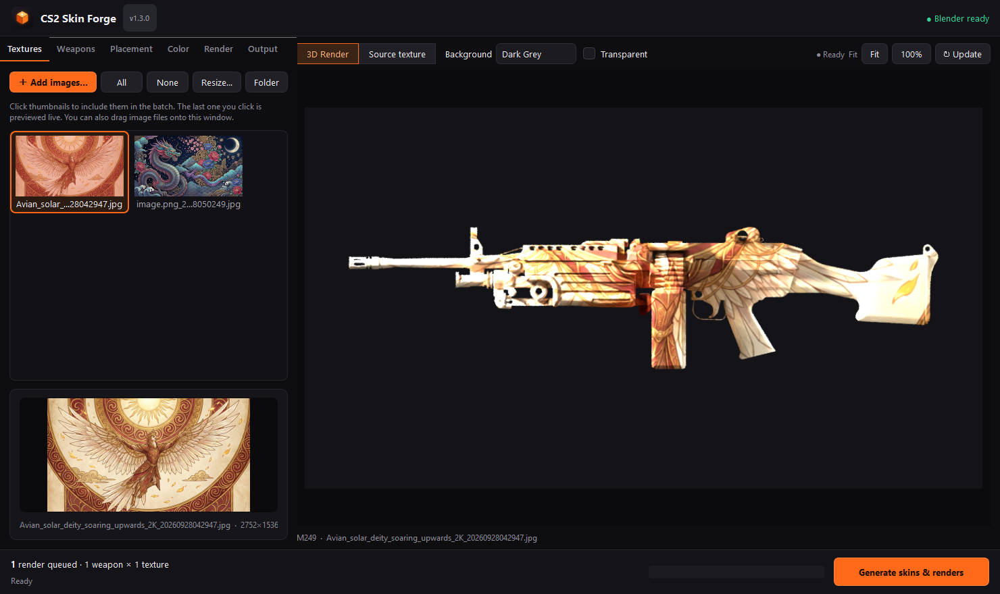
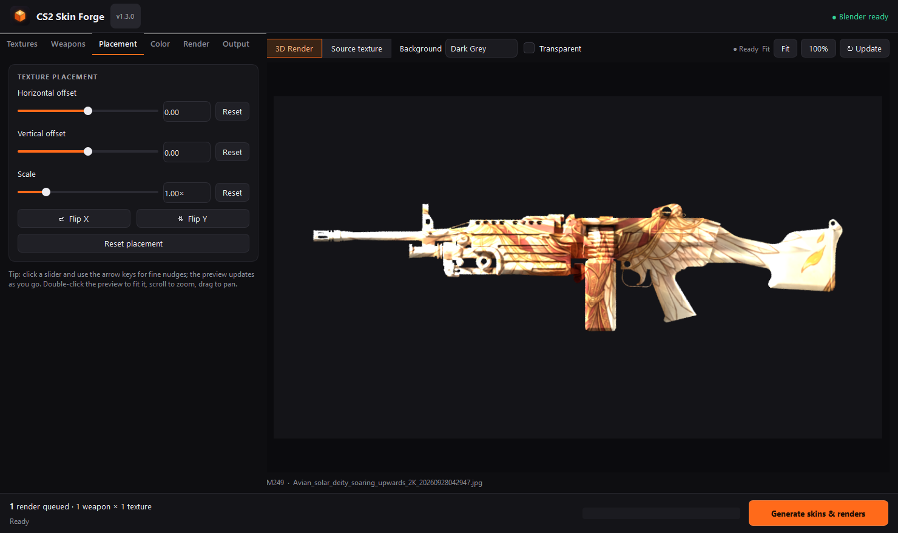
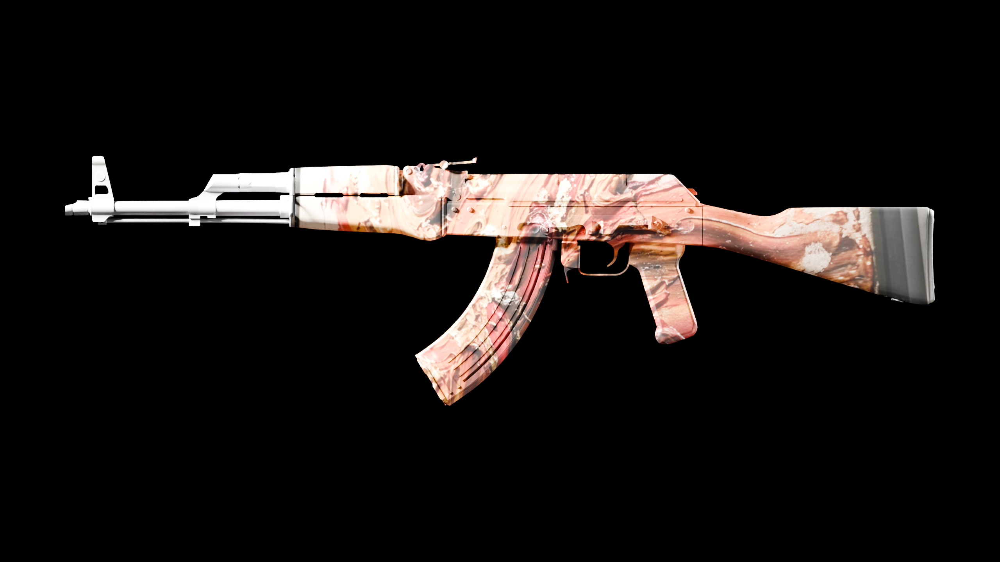
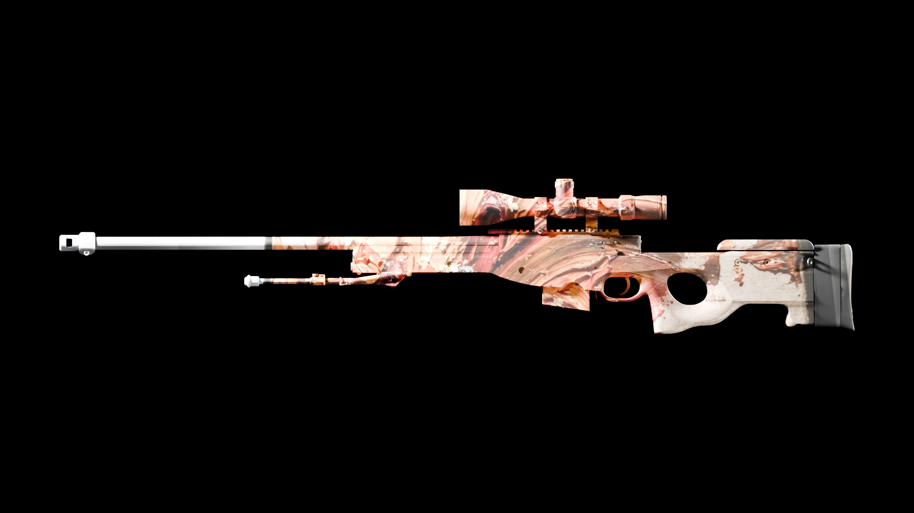
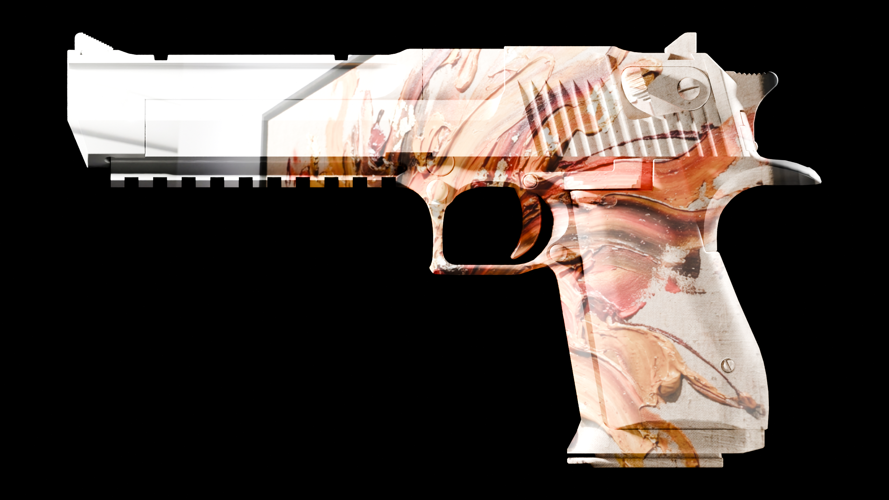
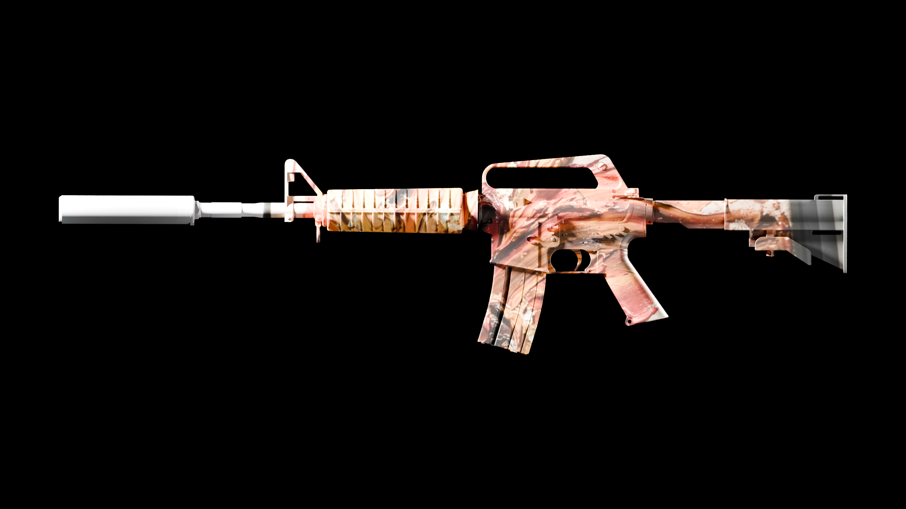

<div align="center">
  
# Antigravity CS2 Skin Forge 🔫🎨

**An automated, headless Python pipeline for generating photorealistic Counter-Strike 2 weapon skins using Blender's CYCLES & EEVEE engines.**

[](https://github.com/Smokianlord/Antigravity-CS2-Skin-Forge/releases/tag/v1.3.0)
[](https://opensource.org/licenses/MIT)
[](https://www.python.org/downloads/)
[](https://www.blender.org/)
[-41cd52)](https://doc.qt.io/qtforpython-6/)

<br>

<p align="center">
  
</p>

</div>

## 📖 Description

**Antigravity CS2 Skin Forge** (version **v1.3.0**), created by **Smokianlord**, is a professional-grade UI and rendering pipeline built specifically for Counter-Strike 2 skin creators, workshop designers, and 3D artists. It completely automates the process of mapping 2D pattern textures onto 3D CS2 weapon models, framing them using mathematical bounding-box orthographic cameras, rendering them through headless Blender (Cycles / Eevee) with studio PBR materials, post-processing them in real time, and exporting production-ready showcases and `.blend` project files in batch.

---

## 🎨 Designed for Designers: Live Preview Always Beside Your Controls

The **3D preview stays on screen at all times** while every feature lives in its own tab, so you never have to hide the result to change a setting. Scroll to zoom, drag to pan, double-click to fit, and switch between the **3D Render** and the **Source texture** with one click.

<p align="center">
  
</p>

- **🖼️ Texture thumbnails + big preview**: The **Textures** tab shows every image as a thumbnail; click to include it in the batch, and the last one you click is shown large below the grid and rendered live on the weapon. Add images with **＋ Add images…** or just drag files onto the window.
- **🗂️ One tab per job**: Textures · Weapons · Placement · Color · Render · Output.
- **🎚️ Precise sliders**: Drag, type an exact value, or nudge with the arrow keys. Each slider has its own Reset.
- **⚡ Smooth UI**: Rebuilt on Qt (PySide6), so resizing and scrolling stay fluid (~5 ms per resize step instead of ~380 ms on the old toolkit).
- **🚀 Faster previews**: Preview renders use cached 1K copies of the large 4K weapon maps.
- **🌈 Color grading**: Brightness / Contrast / Saturation update instantly and are applied identically to the final export (alpha is preserved).
- **🪟 Background & transparency**: Checkerboard for transparent, or Dark Grey / Deep Blue / Pure Black / Pure White / Green Screen.
- **🔁 Flip X / Flip Y**, offsets and scale with center-anchored UV math.
- **🔍 Weapon search**, grouped by category, with Select all / Clear / Random 3.
- **📐 Resize…**: Make a resized copy of a texture (4096 / 2048 / 1024 / 512 or custom); the original is never overwritten.
- **⛔ Cancel** a running batch, and a clear error message if Blender can't be found.

---

## 🖼️ Showcase Gallery (Rendered via Headless Cycles Raytracing)

| AK-47 Showcase | AWP Showcase |
| :---: | :---: |
|  |  |
| **Desert Eagle Showcase** | **M4A1-S Showcase** |
|  |  |

---

## ✨ Key Features

- **All 35 CS2 Weapons Included**: 3D OBJ weapon models are bundled directly inside the standalone executable and organized cleanly in `Assets/Models`.
- **Headless Blender Integration**: Directly interfaces with Blender (CYCLES/EEVEE) in the background with OptiX GPU + CPU Hybrid acceleration.
- **Smart Framing & Alignment**: Uses global bounding-box math and orthographic scales to perfectly frame any weapon size, from a Glock to an AWP, at consistent scales.
- **Auto-Material Generation**: Automatically extracts and injects official Valve CS2 normal and roughness maps into calibrated dielectric PBR shaders (`Metallic = 0.02`, `Specular = 0.25`).
- **Batch Processing**: Render hundreds of weapon-texture permutations automatically ("All Combinations" or "Random Match").
- **Dynamic Lighting Environments**: 4 studio lighting rigs (`Studio Pro`, `Soft Workbench`, `Bright Flat`, `Dark Cinematic`) with live switching in both preview and render pipelines.
- **Full Color Grading Suite**: Built-in Brightness, Contrast, and Saturation slider integration via Python `PIL.ImageEnhance` with instant (<1ms) real-time response.
- **Slide-up Folder Drawer**: Bottom bar with one-click copyable directory paths for easy file management.

---

## 🛠️ Installation

### 1. Prerequisites
You must have the following software installed:
* [Python 3.10+](https://www.python.org/downloads/)
* [Blender](https://www.blender.org/download/) (Installed via Steam at `C:\Program Files (x86)\Steam\steamapps\common\Blender\blender.exe` or automatically discovered across standard system paths)

### 2. Clone the Repository
```bash
git clone https://github.com/Smokianlord/Antigravity-CS2-Skin-Forge.git
cd Antigravity-CS2-Skin-Forge
```

### 3. Install Dependencies
```bash
pip install -r requirements.txt
```

*(Required packages: `PySide6-Essentials`, `Pillow`)*

---

## 🚀 Usage

### Option A: Running the Standalone Executable (.exe)
Download or double-click `Antigravity CS2 Skin Forge.exe`. The 35 official weapon models are bundled directly inside the executable, so it runs completely out of the box!

### Option B: Running from Python Source
```bash
python gui_app.py
```

### Compiling to a Standalone Executable (.exe)
To compile a standalone `.exe` with the weapon models bundled inside:
```bash
pyinstaller --onefile --noconsole --name "Antigravity CS2 Skin Forge" --icon="icon.ico" --add-data "icon.ico;." --add-data "Assets/Models;Assets/Models" --version-file=version.txt gui_app.py
```

### Workflow
1. Launch the app. In the **Textures** tab click **＋ Add images…** (or drag image files onto the window) and click thumbnails to include them; the last one clicked is previewed large and on the weapon.
2. In **Weapons**, check the models to render (search, Select all, Random 3). Click a weapon name to see it in the live preview.
3. In **Placement**, position the pattern (X / Y / Scale / Flip) while watching the live 3D preview. Use **Source texture** to compare with the original image.
4. In **Color**, adjust Brightness / Contrast / Saturation; pick the background (or Transparent) above the preview.
5. In **Render**, choose Lighting, Quality, Engine (Cycles GPU recommended), Format and batch mode. **Output** sets folders and the Blender path.
6. Click **Generate skins & renders** and watch progress at the bottom; **Cancel** stops after the current render.

---

## 📂 Directory Structure

```text
Antigravity-CS2-Skin-Forge/
│
├── "Antigravity CS2 Skin Forge.exe"  # Standalone compiled executable (all models bundled)
├── skinforge_core.py                # Assets, Blender discovery, render commands (no UI)
├── gui_app.py                       # Qt (PySide6) application window
├── blender_headless_render.py       # Headless Blender execution script
├── requirements.txt                 # Python dependencies
├── version.txt                      # Windows Executable metadata for PyInstaller
├── icon.ico                         # Application crosshair icon
├── CHAT_AND_DEVELOPMENT_LOG.md      # Full chronological project history & changelog
│
├── docs/                            # Documentation and media
│   └── images/                      # App screenshots & weapon showcases
│       ├── app_interface.png        # Main GUI preview
│       ├── placement_tab.png        # Placement tab + live preview screenshot
│       └── showcase_*.png           # Photorealistic weapon renders
│
├── Input_Textures/                  # Drop your custom weapon textures here
├── Output_Renders/                  # Rendered showcases appear here
├── Output_Project_Files/            # Automatically saved .blend projects
│
└── Assets/                          # Fully self-contained local assets
    ├── Models/                      # All 35 official weapon .obj models
    └── Textures/                    # Valve CS2 normal & roughness maps
```

---

## 🔧 Configuration

Blender is automatically discovered on your system (Steam paths, standard installation directories, and system PATH). You can also configure a custom Blender executable path directly in the application via:
`Top Ribbon` -> `Configure` -> `Set Blender Executable Path`

---

## 🤝 Contributing

Contributions, issues, and feature requests are welcome! 
Feel free to open an issue or pull request.

1. Fork the Project
2. Create your Feature Branch (`git checkout -b feature/AmazingFeature`)
3. Commit your Changes (`git commit -m 'Add some AmazingFeature'`)
4. Push to the Branch (`git push origin feature/AmazingFeature`)
5. Open a Pull Request

---

## 📝 License

Distributed under the MIT License. See `LICENSE` for more information.

---

<div align="center">
  <i>Created with ❤️ by Smokianlord</i>
</div>
